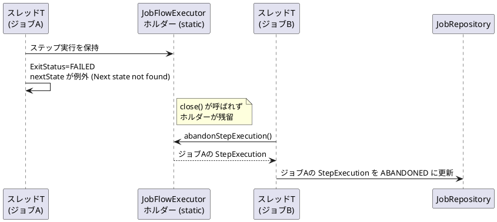

*このドキュメントは生成AI(GitHub Copilot / Claude Sonnet 5.5)によって2026年11月18日に生成されました。*

## 課題概要

[#5514](https://github.com/spring-projects/spring-batch/issues/5514) は、ステップの `ExitStatus` に一致する遷移が `on(...)` で定義されていないジョブは、失敗します(これは仕様どおりの動作です)。このとき、そのジョブの `StepExecution` が同じスレッドで次に動く別のジョブ実行から見えてしまい、そのジョブの状態を書き換えるバグです。

**用語の補足**
- `ThreadLocal`: 値がスレッドごとに分かれる仕組み。`static` の場合は、`JobFlowExecutor` のインスタンスをまたいで、同じスレッドなら同じ値が見えます。インスタンスフィールドなら、インスタンスごと・スレッドごとに値が分かれます。
- `ABANDONED`: 「放棄された」ステップ実行の状態。再起動してもそのステップは実行されません。

**症状**
1. ジョブが自分自身を無効化する。同一スレッドでの次の実行時に、前回のステップ実行が `ABANDONED` にされ、ステップが二度と実行されません(並行処理がなくても発生)。
2. 無関係なジョブが破損する。同じスレッドで次に動いた別ジョブが、最初のジョブのステップ実行を放棄させます。2 番目のジョブのフローが正しくても発生します。
3. 行を所有していないジョブで `OptimisticLockingFailureException` が出る。各スレッドが古いコピーを保持し、他スレッドの更新でバージョンが食い違うためです。

**影響**
- 該当する条件: `on(...)` で `ExitStatus` を網羅しきれていないフローがあり、かつスレッドプールを共有する同期実行である場合です。報告では、9 スレッドの `ThreadPoolTaskScheduler` と、デフォルトの `SyncTaskExecutor` を使う `JobOperator` の組み合わせでした。報告者の本番環境では、フロー定義が不完全な 1 ジョブが再起動まで処理されなくなり、無関係な 3 ジョブのスケジュール実行も停止しました。
- 暫定対策: `on("*")` の包括遷移を追加します。
- 修正は 6.1.0-RC1 です。`for: backport-to-6.0.x` ラベルはありますが、6.0.x へのバックポートは未確認なので、6.0.x 利用者は確認が必要です。

## 原因

原因は次の 2 点の組み合わせです。

1. `JobFlowExecutor` の `stepExecutionHolder`(以下、ホルダー)が `static final ThreadLocal<StepExecution>` だった。実行ごとの状態なのに JVM 全体で共有されていた。
2. `SimpleFlow.resume` で `nextState(...)` が `try` の外にあった。そのため、遷移先が見つからずに例外が出ると `executor.close()` が呼ばれず、ホルダーが残った。

その結果、次のジョブ実行が `StepState.handle` から呼ぶ `abandonStepExecution()` で、他ジョブが残した `StepExecution` を読み書きしました。

メンテナーの fmbenhassine 氏は、コメントで `74975c506` でのリグレッションと見ています。報告者は、関連しそうな [#1826](https://github.com/spring-projects/spring-batch/issues/1826) を「`AbstractStep.execute` のコミット失敗パスに関するもので、別のメカニズム」としています。

## 対応方針

**issue 側の提案**: (a) ホルダーを `static` にしない、(b) `nextState` を `try` 内に移すか `finally` でクリアする。報告者は、どちらか一方でも連鎖は断てるが両方行う価値がある、と主張しています。

**修正の内容**(コミット [9ff78c2b7985](https://github.com/spring-projects/spring-batch/commit/9ff78c2b79855a653e2cc34b880f90da51b967ef))
- `JobFlowExecutor`: ホルダーを `static` から非 static のインスタンスフィールドへ変更。
- `SimpleFlow.resume`: debug ログと `nextState(...)` を `try` 内へ移動。`nextState` が例外を投げても `catch` 経由で `executor.close()` が呼ばれる。
- `FlowJobFailureTests`: 回帰テストを追加(他ジョブへの影響なし、再起動可能、エグゼキュータのクローズ、インスタンス間の分離)。

issue の提案のうち `finally` 案は採用されず、`nextState` を `try` 内へ移す方式のみです。

## バグの発生タイミング

- 確認されたバージョン: 6.0.3(本番インシデント)、6.0.4(サンプル)。
- `74975c506`(メンテナーがリグレッションの原因と推定)で入った可能性があります。混入した最初のバージョンは不明です。
- 修正は 6.1.0-RC1 です。
