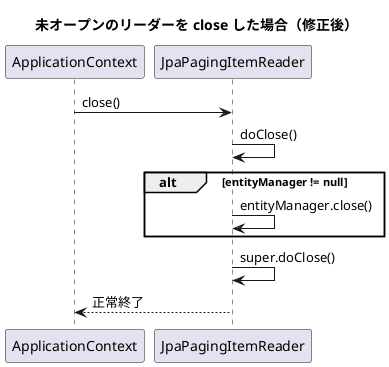

*このドキュメントは生成AI(GitHub Copilot / Claude Sonnet 5.5)によって2026年11月18日に生成されました。*

## 課題概要

一度も `open()` されていない `JpaPagingItemReader` を `close()` すると、`NullPointerException` を原因とする `ItemStreamException`（`Error while closing item reader`）がスローされる不具合です（[#5539](https://github.com/spring-projects/spring-batch/issues/5539)）。

**業務への影響**: `@Bean` で `JpaPagingItemReader` を返し、`destroyMethod` を指定していない場合に該当します。`@Bean` のメソッドは、`close` や `shutdown` という名前の公開メソッドがあると、Spring が自動で破棄時に呼びます。そのため、リーダー Bean がシングルトンとして生成され、ステップが一度も実行されないままアプリケーションコンテキストをシャットダウンすると、この例外が発生しえます。発生するのはシャットダウン時の例外で、ジョブの実行結果や終了コードに影響するかどうかは、入力からは不明です。

**バージョン別の対処**: 修正はマイルストーン 6.1.0-RC1 で入ります。6.0.x 利用者向けのバックポート済みリリースが出るまでの回避策（`destroyMethod=""` の指定など）は、入力に記載がありません。

**期待される動作**: `EntityManager` が作成されていなければその後始末だけをスキップし、スーパークラスの後始末は引き続き実行すること。挙動が変わるのは未オープン時のみで、オープン済みの場合は従来どおり `entityManager.close()` と `super.doClose()` を実行します。

## 原因

`JpaPagingItemReader` の `entityManager` フィールドは `doOpen()` でのみ代入されます。一方、`doClose()` は `entityManager` が `null` かどうかを確認せず、無条件に `entityManager.close()` を呼び出していました。そのため、`open()` を経ずに `close()` が呼ばれると `NullPointerException` になります。

報告者は、ページングリーダーにおけるこのガードのない `close` が、JSpecify（null 安全性の注釈を付与する取り組み）への移行前から存在していたと述べています。移行が原因だとは主張していません。

## 対応方針

報告者は issue のコメントで、`JpaCursorItemReader` に対する [#5486](https://github.com/spring-projects/spring-batch/issues/5486) / [#5489](https://github.com/spring-projects/spring-batch/issues/5489) と同様に、`doClose()` 内の `EntityManager` のクリーンアップを null チェックでガードし、スーパークラスのクリーンアップは維持する方針を示しました。

修正コミット [d2f3518093ac](https://github.com/spring-projects/spring-batch/commit/d2f3518093ac6cb7fd22b1ec54cd36feb8c18e7d)（2026-09-30）の diff の内容は次のとおりです。

- `JpaPagingItemReader.doClose()`
  - `entityManager != null` の場合のみ `entityManager.close()` を呼ぶようにした
  - `super.doClose()` は常に実行する
  - IDE の静的解析が出す null 警告を抑える `@SuppressWarnings("DataFlowIssue")` を、不要になったため削除した（動作には影響しない。issue 本文には言及なし）
- テスト `JpaPagingItemReaderTests`（新規追加）
  - `closeShouldNotThrowWhenReaderWasNeverOpened`: 未オープンで `close()` しても例外が発生しないことを確認
  - `closeShouldCloseEntityManagerWhenReaderWasOpened`: オープン後の `close()` で `EntityManager.close()` が呼ばれることを確認

## バグの発生タイミング

- **発生バージョン**: 入力からは特定できません（不明）。issue では main ブランチの `a3028e3c8f78c0e385cb61fb800afb32b5f7846a` で再現を確認したと記載があり、JSpecify への移行前から存在していたと報告者が述べています。
- **バグが発生したコミット**: 入力に記載がなく不明です。
- **修正**: マイルストーン 6.1.0-RC1。コミット [d2f3518093ac](https://github.com/spring-projects/spring-batch/commit/d2f3518093ac6cb7fd22b1ec54cd36feb8c18e7d)。
- `for: backport-to-6.0.x` ラベルが付いており、6.0.x へのバックポートが予定されています。実施済みかどうかは入力からは分かりません。
