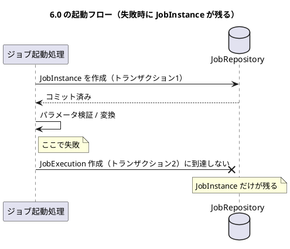

*このドキュメントは生成AI(GitHub Copilot / Claude Sonnet 5.5)によって2026年11月18日に生成されました。*

## 課題概要

ジョブ起動が途中で失敗したとき、`JobExecution` を持たない `JobInstance` が `JobRepository` に残ってしまう問題です（[#5562](https://github.com/spring-projects/spring-batch/issues/5562)）。

報告者は `java.time.Year` 型のパラメータを渡し、次の例外に遭遇しました。

```
ConverterNotFoundException: No converter found capable of converting from type [java.time.Year] to type [java.lang.String]
```

その上で、例外にもかかわらず `JobInstance` が DB に永続化されていることを指摘しています。報告者の主張は `Year` のコンバーターが無いこと自体ではありません。設定ミスなど、ジョブのビジネスロジックとは無関係な起動時エラーでも、`JobExecution` のない `JobInstance` が残ることを問題としています。

再現環境: Spring Boot 4.1.1 / Spring Batch 6.0.5 / Java 25 / H2

### 5.x と 6.0 の違い（メンテナのコメントに基づく）

5.x ではパラメータ検証の後、`JobInstance`・`JobExecution`・パラメータを単一トランザクションで作成するため、失敗時は何も永続化されません。6.0 では `JobInstance` の作成が独自トランザクションで先にコミットされ、パラメータ検証はその後になります。



### 業務への影響

| 事象 | 内容 |
|---|---|
| 同一パラメータでの再起動失敗 | `IllegalStateException: Cannot find any job execution for job instance` が発生 |
| `startNextInstance` の阻害 | incrementer を持つジョブで、次のインスタンス起動が妨げられると報告されている |
| 発生契機 | 変換エラーに限らず、パラメータ検証エラー・永続化エラーでも発生 |

6.0 へ移行したバッチでは、起動時の変換・検証エラーの後に同じパラメータで再実行すると、`IllegalStateException` になり得ます。確認観点は次のとおりです。

- 起動失敗後に、`JobExecution` を持たない `JobInstance` が `JobRepository` に残っていないか確認する。
- ジョブパラメータの型を、事前に文字列へ変換可能な型に限定する。

## 原因

上図のとおり、6.0 では `JobInstance` のコミット後にパラメータ検証と `JobExecution` の作成が行われます。この途中で失敗すると `JobInstance` だけが残ります。メンテナは、これを意図された動作ではなく 5.x に対する 6.0 のリグレッションと確認しています。

## 対応方針

- メンテナ（fmbenhassine）は 6.1.0-RC1 での修正を予定しています。具体的な修正方式は未定です。報告者の期待は、起動時に予期しない例外が起きても `JobExecution` のない `JobInstance` を残さないことです。
- 同梱の diff は `.gitignore` の更新のみで、本件の修正コードは含まれていません。

## バグの発生タイミング

- **発生バージョン**: 6.0 系（報告は 6.0.5）。5.x では発生せず、5.x からのリグレッションです。6.0.0 が最初かどうかは入力から断定できません。
- **発生コミット**: 入力に記載がなく不明です。
