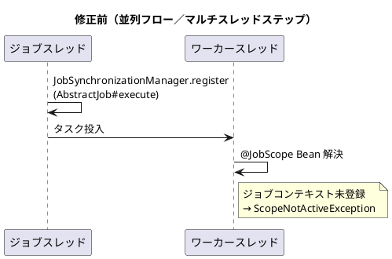

*このドキュメントは生成AI(GitHub Copilot / Claude Sonnet 5.5)によって2026年11月18日に生成されました。*

## 課題概要

[#5576](https://github.com/spring-projects/spring-batch/issues/5576) は、`@JobScope` の Bean を `Job` 実行スレッド以外で解決できないバグです。

並列フローやマルチスレッドステップで `@JobScope` の Bean（ジョブパラメータを受け取る Bean など）を使うと、ジョブが失敗します。`@StepScope` なら同じ状況でも動きます。

現在のジョブ／ステップのコンテキストは `ThreadLocal` で保持されるため、ワーカースレッドで登録されていないと解決できません。`JobSynchronizationManager` は、ジョブコンテキスト（`JobContext`）をスレッドに登録・解除するクラスです。

逐次ステップは成功し、マルチスレッドステップ（`TaskExecutor` 設定済みの `ChunkOrientedStep` のワーカースレッド）と並列フロー（`FlowBuilder#split(TaskExecutor)`）は失敗します。

エラー:

```
org.springframework.beans.factory.support.ScopeNotActiveException: Error creating bean with name 'scopedTarget.jobScopedBean': Scope 'job' is not active for the current thread; ...
Caused by: java.lang.IllegalStateException: No context holder available for job scope
```

`JobSynchronizationManager` の javadoc は、ワーカースレッドを含む全スレッドで `JobContext` を使えるようにするのは `Job` 実装の責任だと定めています。上記2ケースではこれが守られていませんでした。



期待動作は、ジョブに関わる全スレッドで解決でき、同一インスタンスが参照されることです。

並列フローやマルチスレッドステップで `@JobScope` を使っている場合に影響を受けます。修正は 6.1.0-RC1 に入り、6.0.x へのバックポートも予定されています。回避策は入力に記載なし。

## 原因

- `JobSynchronizationManager` への登録が `AbstractJob#execute`、つまりジョブを実行するスレッドでしか行われていなかった。
- ステップ側はワーカースレッドにも登録する仕組みがあったが、ジョブ側にはなく、ジョブを実行したスレッドにしか登録されなかった。

## 対応方針

**issue 本文の方針**: ジョブ実行に関わる全スレッドで `@JobScope` Bean を解決できるようにする。本件は `@JobScope` の伝播のみが対象で、`@FlowScope` の要望は [#4782](https://github.com/spring-projects/spring-batch/issues/4782) 側の話であり対象外です。

**diff の解析**（コミット [2f9e839dea2f](https://github.com/spring-projects/spring-batch/commit/2f9e839dea2fb364bf78a9262e938c816aed6490)）: 別スレッドで実行される箇所に、`JobSynchronizationManager.register(...getJobExecution())` と `close()` を（`finally` で）対にして追加しています。修正は次の3グループです。

- **並列フロー**（`SplitState`）: `FlowBuilder#split(TaskExecutor)` で並列フローを使うジョブが直ります。
- **マルチスレッドステップ**（`StepContextRepeatCallback`、`ChunkOrientedStep`、`ChunkTaskExecutorItemWriter`）: `TaskExecutor` を設定したチャンク指向ステップで、処理・書き込みがワーカースレッドで走るジョブが直ります。
- **非同期処理**（`AsyncItemProcessor`、`AbstractStep`）: `AsyncItemProcessor` で別スレッド処理をするジョブが直ります。`AbstractStep` はコメント上パーティショニング対策です。

新規テスト `JobScopeMultiThreadingTests` は、逐次、マルチスレッドステップ、並列フローの3ケースで完了することと、`seenInstances.size() == 1`（同一インスタンス）を検証します。

**issue 本文と diff の齟齬**: diff には、issue 本文にない `AbstractStep`（コメント上はパーティショニング対策）、`AsyncItemProcessor`、`ChunkTaskExecutorItemWriter` の修正も含まれます。つまり実際の修正範囲は本文より広いです。

## バグの発生タイミング

- 発生バージョン: 入力には導入バージョンの記載がありません。確認された時点は `main`（`eab562ff4e309f307b905ade2453054ca2b6b1bc`）で、マイルストーンは 6.1.0-RC1、`for: backport-to-6.0.x` ラベルから 6.0.x にも修正が適用される予定です（6.0.x で同事象が起きると断定はできません）。
- バグが発生したコミット: 入力から特定できません。修正コミットは [2f9e839dea2f](https://github.com/spring-projects/spring-batch/commit/2f9e839dea2fb364bf78a9262e938c816aed6490) です。
