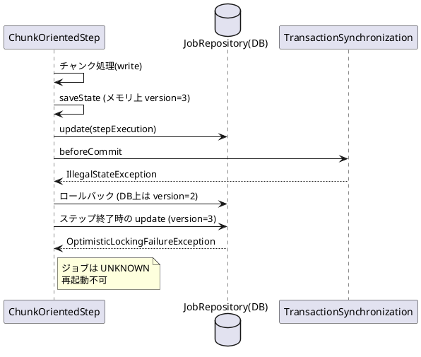

*このドキュメントは生成AI(GitHub Copilot / Claude Sonnet 5.5)によって2026年11月18日に生成されました。*

## 課題概要

`ChunkOrientedStep`（Spring Batch 6 の新しいチャンク処理エンジン）で、チャンク処理とメタデータ更新が成功した後にトランザクションがコミットされず（例: `TransactionSynchronization` の `beforeCommit` が例外をスロー）ロールバックされると、ジョブが `UNKNOWN` のまま残り、通常の再起動ができなくなるバグです。互換チャンクエンジンでは同じ設定で `FAILED` が記録され、正常に再起動できます。

**補足**
- `TransactionSynchronization`: トランザクションの `beforeCommit` や `afterCompletion` で処理を差し込める Spring の仕組みです。`afterCompletion` には `STATUS_COMMITTED` / `STATUS_ROLLED_BACK` / `STATUS_UNKNOWN` が渡されます。
- `UNKNOWN`: 実行結果が確定できないステータスです。コミットされたかロールバックされたか不明なため、再実行すると二重処理の恐れがあり、Spring Batch は通常の再起動を拒否します。
- `StepExecution` のバージョン: メタデータ更新時の楽観的ロックに使われる値です。

**業務への影響**
- 影響を受ける条件: `ChunkOrientedStep` を使い、JDBC `JobRepository` と業務書き込みが同じ `DataSource` / `DataSourceTransactionManager` を共有する構成で、コミット直前に失敗が起きる場合です。
- 起きること: ジョブが `UNKNOWN` になり、再起動が拒否されるため、DB を手で直す対応が必要になります。
- 対応: 6.1.0-RC1 以降へ更新します。6.0.x へのバックポートは未確認です。

**環境**: Spring Batch 6.0.5、Spring Framework 7.0.9、Java 17、PostgreSQL 17.11。main（6.1.0-SNAPSHOT）でも再現します。

**再現手順（要点）**: チャンクサイズ 1 で 3 件処理し、2 回目の書き込みで `beforeCommit` が `IllegalStateException` をスローする同期を登録します。ロールバックされ、レコード 1 のみコミットされた状態になります。期待されるステータスは `FAILED` です。互換チャンクエンジン（`chunk(1, transactionManager)`）は成功します。一方 `ChunkOrientedStep`（`chunk(1).transactionManager(transactionManager)`）は `expected FAILED but was UNKNOWN` で失敗します。

再現プロジェクト: [spring-batch-rollback-reproducer](https://github.com/AndreaBosmanWork/spring-batch/tree/reproduce/chunk-rollback/spring-batch-rollback-reproducer)

## 原因

`saveState` はメモリ上の `StepExecution`（version、カウント、`ExecutionContext`）を先に更新します。ロールバックしてもこの値は戻らず、DB と食い違います（メモリ上は version=3、DB 上は 2）。ステップ終了時の最終メタデータ保存で `OptimisticLockingFailureException`（`Attempt to update step execution id=1 with wrong version (3), where current version is 2`）が起き、ジョブが `UNKNOWN` になります。

## 対応方針

### Issue 本文の提案

Issue 作成者は、`TaskletStep` のトランザクション完了時のリカバリに倣った[修正ブランチ](https://github.com/AndreaBosmanWork/spring-batch/tree/fix/chunk-rollback-metadata)を提示しています。内容は次のとおりです。
- メタデータ更新が始まっていた場合、ロールバック確認後にメタデータのスナップショットを復元する
- 読み取り数とスキップ数は保持する（読み取り済みの事実は結果に依存しないため）
- トランザクション結果が不明な場合は再起動を明示的にブロックする

### 実際の修正（コミット [`be85c66a1b72`](https://github.com/spring-projects/spring-batch/commit/be85c66a1b72e6a8200ca5429e81ae3636333043)）の解析

変更は `ChunkOrientedStep` と、新規テスト `ChunkOrientedStepCommitFailureIntegrationTests` です。

コミット前に `StepExecution` の状態（version、書き込み数、フィルタ数、コミット数、`ExecutionContext`）を新規 record の `StepExecutionState` に保存します。ロールバックされたときはメモリ上の状態をこの保存値へ戻し、`rollbackCount` を加算するため、`FAILED` で再起動できます。結果が不明なときは `UNKNOWN` にして `setTerminateOnly()` を呼び、フローを次のステップへ進めません。スキャンモードでスキップ項目をコミットする経路にも同じ処理を適用しています。

| トランザクション結果 | 挙動 |
|---|---|
| `COMMITTED` | 何もしない |
| `ROLLED_BACK` | 状態を復元し `rollbackCount` を加算 → `FAILED`、再起動可能 |
| `UNKNOWN` | `UNKNOWN` に昇格し `setTerminateOnly()` → 再起動不可 |

テストでは、ロールバック後に `FAILED` になり再起動で完了すること、結果不明時は再起動が拒否されることを確認しています（逐次／並行の両方）。

### 齟齬の確認

Issue の提案（スナップショット復元、読み取り／スキップ数の保持、結果不明時の再起動ブロック）と、diff の内容に大きな齟齬は見られません。ただし入力には提案ブランチがないため、マージ版との完全な一致は未確認です。

## バグの発生タイミング

- 再現が確認されたバージョン: Spring Batch 6.0.5、および main（6.1.0-SNAPSHOT、コミット `de91ffcaccf887c32f86b683d9430ff2329e4818`）。
- バグを混入させたコミットや最初に影響したバージョンは、入力からは分かりません。
- [#5199](https://github.com/spring-projects/spring-batch/issues/5199) と [#5182](https://github.com/spring-projects/spring-batch/issues/5182) は 6.0.2 向けに解決済みの関連 Issue で、本件はそれより後段の失敗です。原因コミットかどうかは不明です。
- 修正はマイルストーン 6.1.0-RC1 で、`for: backport-to-6.0.x` ラベルが付いています。6.0.x への実際のバックポート状況は未確認です。
